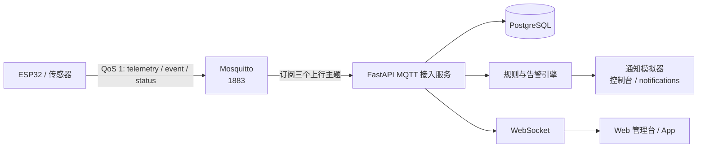

# 硬件端 MQTT 接入与联调指南

本文面向 ESP32、传感器和固件开发人员，目标是不阅读后端源码也能完成注册、
MQTT 接入、数据上报、事件上报和告警联调。

当前消息契约以后端
[`app/mqtt/validation.py`](../app/mqtt/validation.py) 为准；设备侧只使用本指南
列出的主题和字段，不要依赖未写入契约的字段。

> 当前项目是教学演示环境：MQTT 使用明文 `1883`，所有设备共用一组账号口令，
> 没有设备级 ACL。不要把真实个人信息接入公网环境。

## 1. 系统链路



实际链路：

1. 设备向 `iot/v1/{device_uid}/{telemetry|event|status}` 发布 UTF-8 JSON。
2. Broker 校验用户名密码；后端以 QoS 1 订阅三类上行主题。
3. 后端校验主题、`device_uid`、时间戳和载荷字段。
4. 合法遥测写入 `telemetry`；合法事件生成 `event -> alert -> notification`。
5. 设备被任意一条合法消息刷新为在线；超时后由后端判定离线并生成告警。

## 2. 接入前准备

### 2.1 注册设备并绑定老人

设备必须先注册，遥测和事件才能入库。注册与绑定接口仅允许 `admin`。

可在管理台的“设备”页面操作，也可在 Swagger
<http://127.0.0.1:18080/docs> 或 PowerShell 中调用。公网演示环境为管理台
<http://47.108.147.192:3000>、Swagger <http://47.108.147.192:18080/docs>，
管理员口令由部署负责人提供。

```powershell
$base = "http://127.0.0.1:18080"

# 本地演示默认 admin / admin123456；公网演示环境使用部署负责人提供的口令。
$login = Invoke-RestMethod -Method Post `
  -Uri "$base/api/v1/auth/login" `
  -ContentType "application/json" `
  -Body (@{ username = "admin"; password = "admin123456" } | ConvertTo-Json)

$headers = @{ Authorization = "Bearer $($login.access_token)" }

# 可根据已有老人 ID 跳过创建步骤。
$elder = Invoke-RestMethod -Method Post `
  -Uri "$base/api/v1/elders" `
  -Headers $headers `
  -ContentType "application/json" `
  -Body (@{ name = "硬件联调-测试老人" } | ConvertTo-Json)

$device = Invoke-RestMethod -Method Post `
  -Uri "$base/api/v1/devices" `
  -Headers $headers `
  -ContentType "application/json" `
  -Body (@{
    device_uid = "esp32-lab-0001"
    kind       = "esp32"
    model      = "ESP32 DevKit"
  } | ConvertTo-Json)

Invoke-RestMethod -Method Post `
  -Uri "$base/api/v1/devices/$($device.id)/bind" `
  -Headers $headers `
  -ContentType "application/json" `
  -Body (@{ elder_id = $elder.id } | ConvertTo-Json)
```

约束：

- 设备 UID 正则：`^[A-Za-z0-9][A-Za-z0-9_-]{0,63}$`。
- UID 只能是 ASCII 字母、数字、下划线和短横线；首字符必须是字母或数字。
- `kind` 可选值：`esp32`、`phone`、`wearable`；ESP32 使用 `esp32`。
- 重复注册同一 UID 返回 HTTP `409`，不要通过换 UID 规避；应先确认管理台已有设备。
- 一台设备同一时刻只能绑定一位老人；重复绑定或绑定已占用设备返回 `409`。
- 解绑：admin 在管理台设备页点「解绑」，或调用 `POST /api/v1/devices/{id}/unbind`；解绑后设备回到未绑定状态，历史遥测与事件保留。删除老人时也会自动解绑。

### 2.2 获取 Broker 连接凭据

MQTT 账号来自部署目录 `.env` 中的：

```dotenv
MQTT_USER=eldercare
MQTT_PASSWORD=change-me-mqtt
```

以实际 `.env` 为准，不要使用示例值。当前只有一组 MQTT 凭据，所有设备共用；
`device_uid` 是平台业务身份，不是 MQTT 用户名。Broker 没有按设备 UID 限制
发布主题，固件必须自行保证只发布自己的 UID。

公网演示环境（答辩联调）：

- Broker：`47.108.147.192:1883`；试用实例停机重建后 IP 可能变化，以联调群公告为准。
- MQTT 口令由部署负责人在群内提供，不要写进固件仓库或提交到 Git。
- 设备注册/绑定使用管理员账号，可通过管理台 <http://47.108.147.192:3000>
  或 Swagger <http://47.108.147.192:18080/docs> 操作。

## 3. Broker 连接参数

| 参数 | 当前值 | 说明 |
| --- | --- | --- |
| 地址 | 按部署环境确定 | 见下表 |
| 端口 | `1883` | Docker Compose 固定映射 `1883:1883` |
| 用户名 | `.env` 的 `MQTT_USER` | 必填 |
| 密码 | `.env` 的 `MQTT_PASSWORD` | 必填 |
| 匿名连接 | 禁止 | `allow_anonymous false` |
| 上行 QoS | `1` | 三类消息均使用 QoS 1 |
| Keepalive | 建议 `30` 秒 | 后端和模拟器均使用 30 秒 |
| TLS | 当前无 | `1883` 是明文端口 |

设备不在 Docker 网络内时，不要连接容器名 `mosquitto`：

| 设备位置 | Broker 地址 |
| --- | --- |
| 与 Broker 同一台电脑上的本机工具 | `127.0.0.1:1883` |
| 同一局域网内的 ESP32 | 运行 Docker 的电脑 IPv4 地址，例如 `192.168.1.10:1883` |
| 远程/云服务器设备 | 部署服务器公网 IP 或域名，例如 `<SERVER_IP>:1883` |
| 公网演示环境（当前） | `47.108.147.192:1883`；口令由部署负责人提供 |
| `backend` 容器 | `mosquitto:1883`；这是后端内部地址，设备不要使用 |

Windows 可用 `ipconfig` 查局域网 IPv4。物理 ESP32 不能连接 `localhost` 或
`127.0.0.1`，因为那指向 ESP32 自己。云服务器还需在安全组中放行 MQTT 端口，
并尽量限制设备来源 IP。

> 当前链路没有 TLS，用户名、密码和载荷均为明文。仅限内网/演示环境使用；
> 生产级 TLS、证书和设备级 ACL 尚不在当前实现范围内。

## 4. Topic 规范

平台订阅：

```text
iot/v1/+/telemetry   QoS 1
iot/v1/+/event       QoS 1
iot/v1/+/status      QoS 1
```

设备上行主题只能使用以下三类：

| Topic | 方向 | 用途 |
| --- | --- | --- |
| `iot/v1/{device_uid}/telemetry` | 设备到平台 | 心率、血氧、步数、活动、步态、位置、电量 |
| `iot/v1/{device_uid}/event` | 设备到平台 | 跌倒、SOS、围栏越界、低电量事件 |
| `iot/v1/{device_uid}/status` | 设备到平台 | 在线心跳，可同时上报电量 |

规则：

1. Topic 必须恰好是四段：`iot/v1/{device_uid}/{kind}`。
2. 第二段必须是 `v1`，第四段必须是 `telemetry`、`event` 或 `status`。
3. JSON 顶层的 `device_uid` 必须与 Topic 中的 `{device_uid}` 完全一致，包括大小写。
4. 载荷必须是 UTF-8 JSON 对象，顶层数组、空载荷和非法 JSON 会被丢弃。
5. 消息统一使用 QoS 1，不要发布 retained 状态来替代定期心跳。
6. 平台没有订阅下行 Topic；规格中的 `/cmd` 当前未实现，设备无需订阅。
7. MQTT Broker 收到消息并返回 PUBACK，不代表业务数据已经入库；字段非法、
   设备未注册、未绑定或已停用时，后端仍可能确认消息后丢弃。联调必须查看后端日志
   和管理台数据。

## 5. 遥测消息规范

通用格式：

```json
{
  "device_uid": "esp32-lab-0001",
  "ts": "2026-10-09T02:00:00Z",
  "metric": "heart_rate",
  "value": 78
}
```

### 5.1 Metric 与字段

| `metric` | 必填字段 | 取值范围与含义 |
| --- | --- | --- |
| `heart_rate` | `value` | 数值，20 到 250，单位 bpm |
| `spo2` | `value` | 数值，0 到 100，单位 % |
| `steps` | `value` | 数值，必须大于等于 0；按“本采样区间新增步数”上报 |
| `activity` | `value` 或 `value_text` | 数值无显式范围；或非空字符串 |
| `gait` | `value` 或 `value_text` | 数值无显式范围；或非空字符串 |
| `location` | `lat`、`lon` | `lat` 为 -90 到 90，`lon` 为 -180 到 180 |
| `battery` | `value` | 数值，0 到 100，表示电量百分比 |

补充说明：

- 所有数值必须是有限值；`NaN`、`Infinity`、布尔值和数字字符串都不合法。
- `activity`、`gait` 使用 `value_text` 时，后端不会校验固定枚举。
  管理台/模拟器的 `walking`、`resting`、`sleeping` 只是示例值。
- `activity`/`gait` 如果使用数值 `value`，会作为 `value_num` 存储，
  但当前活动趋势按 `value_text` 统计。
- `steps` 当前趋势接口会对上报值求和。真实设备若拿到的是累计步数，必须在设备端
  先转换为区间增量，否则趋势会持续放大。
- 电量业务状态会取整数百分比；建议直接上报 `0` 到 `100` 的整数。

### 5.2 时间戳

`ts` 必须是字符串形式的 ISO 8601，并且必须带显式时区：

```text
2026-10-09T02:00:00Z
2026-10-09T10:00:00+08:00
2026-10-09T10:00:00.123+08:00
```

不允许：

```text
2026-10-09T02:00:00
```

后端会把带偏移的时间统一转换为 UTC 保存。设备端优先发送 UTC：
`2026-10-09T02:00:00Z`。ESP32 未完成 NTP 校时时不要上报业务数据。

### 5.3 每类遥测示例

```json
{"device_uid":"esp32-lab-0001","ts":"2026-10-09T02:00:01Z","metric":"heart_rate","value":78}
{"device_uid":"esp32-lab-0001","ts":"2026-10-09T02:00:02Z","metric":"spo2","value":97}
{"device_uid":"esp32-lab-0001","ts":"2026-10-09T02:00:03Z","metric":"steps","value":12}
{"device_uid":"esp32-lab-0001","ts":"2026-10-09T02:00:04Z","metric":"activity","value_text":"walking"}
{"device_uid":"esp32-lab-0001","ts":"2026-10-09T02:00:05Z","metric":"gait","value_text":"steady"}
{"device_uid":"esp32-lab-0001","ts":"2026-10-09T02:00:06Z","metric":"location","lat":31.2304,"lon":121.4737}
{"device_uid":"esp32-lab-0001","ts":"2026-10-09T02:00:07Z","metric":"battery","value":76}
```

每次只上报一个 `metric`，不要在一次 JSON 中塞入多个指标。

## 6. 事件消息规范

通用格式：

```json
{
  "device_uid": "esp32-lab-0001",
  "ts": "2026-10-09T02:10:00Z",
  "type": "fall",
  "severity": "critical",
  "confidence": 0.97,
  "payload": {
    "source": "mpu6050",
    "accel_g": 3.2
  }
}
```

设备可上报的事件类型：

| `type` | 建议 `severity` | 说明 |
| --- | --- | --- |
| `fall` | `critical` | 设备端跌倒算法确认后上报 |
| `sos` | `critical` | 按键、语音或人工触发 |
| `geofence_exit` | `warning` | 可上报。设备侧判定（如 BLE 断连）与平台侧位置判定都支持 |
| `low_battery` | `warning` | 可上报，但正常情况下由平台根据电量遥测生成 |

字段约束：

- `type` 只能是 `fall`、`sos`、`geofence_exit`、`low_battery`。
- `severity` 只能是 `info`、`warning`、`critical`。
- 后端不强制“事件类型和 severity”的固定组合；建议按上表保持语义一致。
- `confidence` 可省略或为 `null`；存在时必须是 0 到 1 之间的数值。
- `payload` 可省略，默认 `{}`；存在时必须是 JSON 对象，不能是 `null` 或数组。
- `ts` 与遥测使用同一套要求：ISO 8601、显式时区。
- `device_offline` 只能由平台离线巡检生成，设备上报会被判为非法事件并丢弃。

告警行为：

- 每条合法设备事件都会写入 `events`，并生成一条 `alerts`。
- 告警通知为模拟实现：有紧急联系人时，每位联系人生成一条 `console` 通知；
  没有联系人时也生成一条无联系人的 `console` 通知。
- 通知状态会写成 `sent`，内容同时打印到后端日志。
- 当前没有按 `severity` 过滤告警。即使上报 `info`，也会生成告警和通知。
- `fall`、`sos` 通常由设备上报；`geofence_exit`、`low_battery` 建议优先上传
  原始位置/电量遥测，由平台规则统一判定，避免设备事件与规则事件重复。
- 设备侧围栏（例如 BLE 断连）与平台侧围栏（中心 + 半径 + `location` 遥测）
  是两种独立判定；同一设备只需选一种，围栏编辑器中的半径仅对上报位置遥测的设备生效。

示例：

```json
{"device_uid":"esp32-lab-0001","ts":"2026-10-09T02:10:00Z","type":"fall","severity":"critical","confidence":0.97,"payload":{"source":"mpu6050","accel_g":3.2}}
{"device_uid":"esp32-lab-0001","ts":"2026-10-09T02:11:00Z","type":"sos","severity":"critical","payload":{"source":"gpio0_button"}}
{"device_uid":"esp32-lab-0001","ts":"2026-10-09T02:12:00Z","type":"geofence_exit","severity":"warning","payload":{"source":"device_rule"}}
{"device_uid":"esp32-lab-0001","ts":"2026-10-09T02:13:00Z","type":"low_battery","severity":"warning","payload":{"battery_percent":15}}
```

## 7. 状态心跳与离线判定

最小心跳：

```json
{
  "device_uid": "esp32-lab-0001",
  "ts": "2026-10-09T02:15:00Z"
}
```

带电量心跳：

```json
{
  "device_uid": "esp32-lab-0001",
  "ts": "2026-10-09T02:15:00Z",
  "battery": 76
}
```

字段规则：

- `battery` 可省略；也兼容字段名 `value`，但不要同时发送两个字段。
- 电量必须是数值，后端先转换为整数，再要求整数结果位于 0 到 100。
  设备端应直接发送整数，避免小数截断造成边界差异。
- 心跳不会写入 `telemetry` 历史表，只更新设备状态和最近在线时间。
- 需要电量历史趋势时，除心跳外还要发送 `metric=battery` 的遥测。
- `status` 不要求设备已经绑定老人；未绑定时仍可刷新在线状态和电量，
  但由于没有关联老人，不会生成低电量告警或离线告警。

在线规则：

- 任何一条通过校验、且设备已注册/未停用的 `telemetry`、`event`、`status`
  消息都会把设备设为 `online`。
- `last_seen_at` 使用后端收到消息时的服务器时间，不使用载荷中的 `ts`。
- 心跳建议每 30 秒一次，不应超过 60 秒。这样允许一次或两次网络抖动，
  且与后端 30 秒 keepalive 配置一致。

离线规则：

- 后端每 15 秒执行一次巡检。
- 在线设备超过 120 秒没有任何合法上行消息时，状态改为 `offline`。
- 已绑定老人的离线设备会生成 `device_offline` 事件、告警和通知。
- 从最后一条消息到告警可见，通常约 120 到 135 秒；联调时按约 2 分 15 秒观察。
- 设备恢复上报后会自动回到 `online`；下一次再次超时会重新生成离线告警。

## 8. 重复消息与去重

MQTT QoS 1 是“至少一次”语义，网络重连或 PUBACK 丢失时可能重投，设备端必须允许
后端去重。

### 8.1 遥测去重键

后端在同一设备范围内比较以下全部字段：

```text
device_id
metric
recorded_at
value_num
value_text
lat
lon
```

全部相同才判定为重复。重复消息只刷新设备在线时间，不再写入遥测，也不会重新触发
围栏或低电量规则。

### 8.2 事件去重键

后端在同一设备范围内比较以下全部字段：

```text
device_id
type
severity
occurred_at
confidence
payload_json
```

全部相同才判定为重复。重复事件不再生成新的 `event`、`alert`、`notification`。

### 8.3 设备端注意事项

1. 同一个逻辑消息重试时，`ts` 和全部字段必须保持不变。
2. 新采样必须生成新的 `ts`；同一秒内多次上报同值数据时，建议保留毫秒或微秒，
   避免被误判为重复。
3. 不要使用“序号 + 当前时间”的方式重写重试消息；当前契约没有客户端消息 ID。
4. `status` 没有历史去重逻辑，只更新最后状态，重复心跳不会新增 telemetry 记录。
5. 设备未绑定老人时，遥测和事件会在去重前被丢弃；绑定后不会自动补传旧消息。

## 9. 可复制联调示例

### 9.1 mosquitto_pub 命令行

以下命令假定宿主机已安装 `mosquitto_pub`、Docker 栈已启动，并且设备 UID
`esp32-demo-0001` 已注册并绑定。

```powershell
# 从 .env 读取连接参数，避免在命令中硬编码口令。
$mqttUser = ((Get-Content .env | Where-Object { $_ -match '^MQTT_USER=' }) -split '=', 2)[1]
$mqttPassword = ((Get-Content .env | Where-Object { $_ -match '^MQTT_PASSWORD=' }) -split '=', 2)[1]
$uid = "esp32-demo-0001"
$ts = (Get-Date).ToUniversalTime().ToString("yyyy-MM-dd'T'HH:mm:ss'Z'")

# 心跳
$heartbeat = @{
  device_uid = $uid
  ts         = $ts
  battery    = 76
} | ConvertTo-Json -Compress

mosquitto_pub -h 127.0.0.1 -p 1883 -q 1 `
  -u $mqttUser -P $mqttPassword `
  -t "iot/v1/$uid/status" -m $heartbeat

# 心率遥测
$heartRate = @{
  device_uid = $uid
  ts         = $ts
  metric     = "heart_rate"
  value      = 78
} | ConvertTo-Json -Compress

mosquitto_pub -h 127.0.0.1 -p 1883 -q 1 `
  -u $mqttUser -P $mqttPassword `
  -t "iot/v1/$uid/telemetry" -m $heartRate

# 跌倒事件
$fall = @{
  device_uid = $uid
  ts         = $ts
  type       = "fall"
  severity   = "critical"
  confidence = 0.97
  payload    = @{
    source   = "mpu6050"
    accel_g  = 3.2
  }
} | ConvertTo-Json -Depth 5 -Compress

mosquitto_pub -h 127.0.0.1 -p 1883 -q 1 `
  -u $mqttUser -P $mqttPassword `
  -t "iot/v1/$uid/event" -m $fall
```

如果 Windows 未安装 `mosquitto_pub`，可安装 Eclipse Mosquitto 客户端，或在
已启动的 `mosquitto` 容器内执行等价的 `mosquitto_pub` 命令。

### 9.2 ESP32 MicroPython 示例

示例使用 `umqtt.simple`，明确以 QoS 1 发布。常见 Arduino `PubSubClient`
的默认 `publish()` 不应直接视为 QoS 1；若使用该库，先确认所用版本是否支持
QoS 1，否则改用支持 QoS 1 的 MQTT 客户端。

```python
import json
import time

import network
import ntptime
from machine import ADC, Pin
from umqtt.simple import MQTTClient

WIFI_SSID = "YOUR_WIFI"
WIFI_PASSWORD = "YOUR_WIFI_PASSWORD"

BROKER_HOST = "192.168.1.10"   # 改成 Docker 主机局域网 IP 或服务器公网 IP
BROKER_PORT = 1883
MQTT_USER = "eldercare"
MQTT_PASSWORD = "change-me-mqtt"

DEVICE_UID = "esp32-lab-0001"  # 必须已在平台注册并绑定老人

STATUS_INTERVAL_SECONDS = 30
TELEMETRY_INTERVAL_SECONDS = 10

client = MQTTClient(
    client_id=DEVICE_UID,
    server=BROKER_HOST,
    port=BROKER_PORT,
    user=MQTT_USER,
    password=MQTT_PASSWORD,
    keepalive=30,
)

mqtt_connected = False

# 仅作示例。实际项目请按电池分压和 ADC 曲线标定。
battery_adc = ADC(Pin(34))
battery_adc.atten(ADC.ATTN_11DB)

sos_button = Pin(0, Pin.IN, Pin.PULL_UP)
last_sos_level = 1


def ensure_wifi():
    wlan = network.WLAN(network.STA_IF)
    wlan.active(True)
    if wlan.isconnected():
        return

    wlan.connect(WIFI_SSID, WIFI_PASSWORD)
    for _ in range(100):
        if wlan.isconnected():
            print("WiFi connected:", wlan.ifconfig()[0])
            return
        time.sleep(0.2)
    raise OSError("WiFi connect timeout")


def ensure_time():
    # 时间未同步时，避免上报 2000 年的错误时间戳。
    if time.gmtime()[0] >= 2024:
        return
    ntptime.settime()
    time.sleep_ms(100)


def now_iso8601():
    t = time.gmtime()
    return "{:04d}-{:02d}-{:02d}T{:02d}:{:02d}:{:02d}Z".format(
        t[0], t[1], t[2], t[3], t[4], t[5]
    )


def read_battery_percent():
    raw = battery_adc.read()
    return max(0, min(100, int(raw * 100 / 4095)))


def ensure_mqtt():
    global mqtt_connected
    if mqtt_connected:
        return
    client.connect()
    mqtt_connected = True
    print("MQTT connected:", BROKER_HOST)


def send(kind, payload):
    global mqtt_connected
    payload["device_uid"] = DEVICE_UID
    payload["ts"] = now_iso8601()
    topic = "iot/v1/{}/{}".format(DEVICE_UID, kind)
    body = json.dumps(payload)

    ensure_mqtt()
    try:
        client.publish(topic, body, qos=1)
    except OSError:
        mqtt_connected = False
        raise


def publish_status():
    send("status", {"battery": read_battery_percent()})


def publish_telemetry():
    # 下面数值仅用于联调，接入真实传感器后替换。
    send("telemetry", {"metric": "heart_rate", "value": 78})
    send("telemetry", {"metric": "spo2", "value": 97})
    send("telemetry", {"metric": "steps", "value": 12})
    send("telemetry", {"metric": "activity", "value_text": "walking"})
    send("telemetry", {"metric": "location", "lat": 31.2304, "lon": 121.4737})
    send("telemetry", {"metric": "battery", "value": read_battery_percent()})


def handle_sos_button():
    global last_sos_level
    level = sos_button.value()
    if last_sos_level == 1 and level == 0:
        send(
            "event",
            {
                "type": "sos",
                "severity": "critical",
                "payload": {"source": "gpio0_button"},
            },
        )
    last_sos_level = level


def publish_fall_example():
    # 跌倒算法确认后调用；这是示例，不在主循环中自动触发。
    send(
        "event",
        {
            "type": "fall",
            "severity": "critical",
            "confidence": 0.97,
            "payload": {"source": "accelerometer", "accel_g": 3.2},
        },
    )


def main():
    global mqtt_connected
    last_status = 0
    last_telemetry = 0

    while True:
        try:
            ensure_wifi()
            ensure_time()
            ensure_mqtt()

            now = time.time()
            if now - last_status >= STATUS_INTERVAL_SECONDS:
                publish_status()
                last_status = now

            if now - last_telemetry >= TELEMETRY_INTERVAL_SECONDS:
                publish_telemetry()
                last_telemetry = now

            handle_sos_button()
        except OSError as exc:
            mqtt_connected = False
            print("network error, retrying:", exc)
            try:
                client.disconnect()
            except Exception:
                pass
            time.sleep(2)

        time.sleep_ms(100)


main()
```

替换项：

- `WIFI_SSID`、`WIFI_PASSWORD`、`BROKER_HOST`、MQTT 账号和 `DEVICE_UID`。
- `battery_adc` 与 `read_battery_percent()` 按实际电池分压和标定曲线修改。
- 心率、血氧、步数、活动和位置示例值替换为真实传感器数据。
- `publish_fall_example()` 接入实际跌倒检测结果后调用。

## 10. 联调步骤

> 直接对接公网演示环境时：跳过第 1-2 步的本地启动与 seed，Broker 使用
> `47.108.147.192:1883`，设备注册/绑定走管理台或 Swagger，口令找部署负责人
> 获取；后续步骤相同，管理台地址相应改为 `http://47.108.147.192:3000`。

1. 启动并确认服务就绪：

   ```powershell
   docker compose up -d --build
   docker compose ps -a
   Invoke-RestMethod http://127.0.0.1:18080/readyz
   ```

2. 初始化演示数据（如尚未执行）：

   ```powershell
   docker compose exec backend python -m scripts.seed
   ```

   演示设备为 `esp32-demo-0001`，已绑定“演示老人-张奶奶”和演示围栏。

3. 注册并绑定自己的设备，步骤见第 2.1 节。

4. 发布心跳，确认设备状态：

   - 管理台概览的在线设备数增加。
   - 设备页面显示 `online`、最近在线时间和电量。
   - 后端日志出现 `设备状态更新 device_uid=...`。

5. 发布心率、血氧、步数和位置遥测：

   ```powershell
   $headers = @{ Authorization = "Bearer $($login.access_token)" }
   Invoke-RestMethod `
     -Uri "$base/api/v1/elders/$($elder.id)/telemetry?metric=heart_rate" `
     -Headers $headers
   ```

   管理台健康页应能查到心率/血氧/步数/活动趋势；老人详情页可看到最近遥测。

6. 触发事件并检查告警闭环：

   ```powershell
   docker compose exec backend python -m scripts.simulate_device --scenario fall
   docker compose exec backend python -m scripts.simulate_device --scenario sos
   docker compose logs backend --tail 20
   ```

   预期链路：`event -> alert -> notification -> WebSocket -> 管理台告警中心`。

7. 触发规则型事件：

   ```powershell
   # 先 80%，再 15%，跨过 20% 阈值后触发一次低电量告警。
   docker compose exec backend python -m scripts.simulate_device --scenario low-battery

   # 先在围栏中心上报，再上报围栏外位置。
   docker compose exec backend python -m scripts.simulate_device --scenario geofence
   ```

8. 查询并确认告警：

   ```powershell
   $alerts = Invoke-RestMethod -Uri "$base/api/v1/alerts" -Headers $headers
   $target = $alerts | Where-Object { $_.status -eq "new" } | Select-Object -First 1
   Invoke-RestMethod `
     -Method Post `
     -Uri "$base/api/v1/alerts/$($target.id)/ack" `
     -Headers $headers
   ```

   告警状态由 `new` 变为 `handled`；重复确认是幂等的。

9. 验证离线告警：

   - 停止设备上报，保持设备已绑定。
   - 等待约 2 分 15 秒。
   - 查询 `/api/v1/alerts`，应看到 `device_offline`。
   - 恢复心跳后，设备重新显示 `online`。

10. 查看后端日志：

   ```powershell
   docker compose logs -f backend
   ```

   关键日志包括：

   ```text
   遥测入库 device_uid=... metric=...
   事件入库 device_uid=... type=...
   [通知模拟] ...
   离线巡检生成 N 条设备离线告警
   ```

## 11. 排障表

| 现象 | 常见原因 | 定位方法 |
| --- | --- | --- |
| 连接被拒绝 | Broker 未启动、IP/端口错误、ESP32 连了 `127.0.0.1` | `docker compose ps -a`；`Test-NetConnection <BROKER_IP> -Port 1883` |
| `not authorised` | `MQTT_USER`/`MQTT_PASSWORD` 与 `.env` 不一致；改后未重启 Broker | 核对 `.env`；`docker compose restart mosquitto`；查看 `docker compose logs mosquitto` |
| 发布成功但无数据 | Topic 段数/拼写错误，或 JSON 顶层不是对象 | 检查 `iot/v1/{uid}/{kind}`；查看后端 WARN 日志 |
| 消息被丢弃：UID 不一致 | Topic 中 UID 与 JSON 的 `device_uid` 不同 | 两者逐字符一致，包括大小写 |
| 消息被丢弃：设备未注册 | 只在 Broker 连接成功，未调用设备注册接口 | 管理台设备页或 `GET /api/v1/devices` 确认 UID |
| 消息被丢弃：设备未绑定 | 遥测或事件先于绑定到达 | 先完成绑定；未绑定消息不会补传 |
| 消息被丢弃：设备已停用 | 设备状态为 `disabled` | 设备页确认状态，由平台管理侧恢复 |
| 消息被丢弃：时间戳错误 | `ts` 缺失、无时区或不是 ISO 8601 | 使用 `2026-10-09T02:00:00Z` 或带 `+08:00` |
| 消息被丢弃：数值越界 | 心率、血氧、电量、位置或步数超出范围 | 对照第 5.1 节；ESP32 端先做范围裁剪/拒发 |
| 遥测显示但趋势不完整 | `activity` 用数值而非 `value_text`，或 `steps` 上报累计值 | 活动使用文本；步数上报区间增量 |
| 低电量告警不触发 | 未跨过 20% 阈值、设备未绑定、或之前已经低于 20% | 先上报 `>=20`，再上报 `<20`；保持绑定 |
| 低电量告警只出现一次 | 规则只在从 `>=20` 降到 `<20` 时触发一次 | 继续低于 20% 不会重复告警；恢复后再下降可重新触发 |
| 围栏告警不触发 | 无启用围栏、上一位置已在围栏外、位置未变化或设备未绑定 | 先上报围栏内位置，再上报围栏外位置；核对围栏半径和中心 |
| 离线告警不触发 | 设备从未在线、未绑定老人、或未超过阈值 | 先发一条合法心跳；等待约 2 分 15 秒；查看设备 `last_seen_at` |
| 离线时间与设备时间不一致 | 在线判定使用平台服务器时间，不使用消息 `ts` | 以管理台和后端日志时间为准 |
| 同一事件出现多次告警 | 重试时修改了 `ts`、`severity`、`confidence` 或 `payload` | 重试保持全部字段不变；每个新事件使用新 `ts` |
| QoS 1 收到 PUBACK 但平台无记录 | PUBACK 只表示 Broker 接单；业务层可能已丢弃 | 用后端日志和管理台确认，不能仅凭设备侧发布成功判断 |

常用定位命令：

```powershell
docker compose ps -a
docker compose logs backend --since 10m
docker compose logs mosquitto --tail 100
Invoke-RestMethod http://127.0.0.1:18080/readyz
Test-NetConnection 127.0.0.1 -Port 1883
```

## 12. 验收 Checklist

- [ ] ESP32 能连接 WiFi，并能通过 NTP 获取 UTC 时间。
- [ ] 能使用 `.env` 中的 MQTT 账号连接 `1883`，无匿名连接。
- [ ] 设备 UID 已注册，且没有返回 `409`。
- [ ] 设备已绑定到正确的老人。
- [ ] Topic 严格为 `iot/v1/{device_uid}/{kind}`。
- [ ] 每条 JSON 的 `device_uid` 与 Topic 中 UID 完全一致。
- [ ] 每条消息的 `ts` 都带时区，并为新数据生成新时间戳。
- [ ] `status` 每 30 秒发送一次，设备在管理台显示在线。
- [ ] `heart_rate`、`spo2`、`steps`、`activity`、`location`、`battery` 均可入库。
- [ ] `gait` 如已接入，可通过遥测接口查到。
- [ ] 心率、血氧、电量、位置和步数均在合法范围内。
- [ ] 步数按区间增量上报，不是累计总步数。
- [ ] 同一逻辑消息重试时字段不变，平台不产生重复记录。
- [ ] `fall` 和 `sos` 能在告警中心生成告警。
- [ ] 电量从 `>=20` 降到 `<20` 能生成一次低电量告警。
- [ ] 从围栏内上报到围栏外能生成一次围栏告警。
- [ ] 停止上报约 2 分 15 秒后能生成一次设备离线告警。
- [ ] 告警确认操作能把状态改为 `handled`。
- [ ] 后端日志能看到入库、事件和通知模拟输出。
- [ ] 设备端不依赖 `/cmd`、OTA、TLS 或平台下行消息。

## 13. 当前边界

| 能力 | 当前状态 | 硬件端处理 |
| --- | --- | --- |
| MQTT 上行遥测/事件/状态 | 已实现 | 按本指南接入 |
| QoS 1 与应用层去重 | 已实现 | 重试保持逻辑消息字段稳定 |
| MQTT TLS | 未实现 | 当前只能使用明文 `1883` |
| 设备级 MQTT ACL | 未实现 | 所有设备共用账号，固件必须约束自发 Topic |
| 下行 `/cmd` | 未实现 | 不订阅、不依赖 |
| OTA | 未实现 | 使用其他渠道升级固件 |
| 传感器标定 | 不在平台范围 | 由硬件端负责 |
| 原始加速度/PPG 流 | 不在平台范围 | 只上报跌倒事件和降采样 metric |
| 跌倒检测算法 | 不在平台范围 | 设备端确认后上报 `fall` |
| 真实短信/微信通知 | 未实现 | 平台只写通知记录并打印控制台 |
| 离线期间缓存与补传 | 平台未实现队列 | 关键事件如需补传，由设备端自行缓存 |

## 14. 待确认

- 公网演示环境当前为 `47.108.147.192`（API `18080`、MQTT `1883`、管理台 `3000`，
  安全组已放行对应端口）；试用实例停机重建后公网 IP 可能变化，最终地址以联调群
  公告为准。来源 IP 限制未启用，联调期间请使用强口令并避免真实个人数据。
- 生产级 TLS、设备级 ACL、OTA 和下行命令是否后续实现，当前分支没有对应实现。
- Mosquitto 未在仓库配置显式最大消息大小和发布频率限制；如果设备计划高频或
  大载荷上报，需由部署方确认 Broker 限制。
