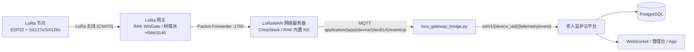

# LoRa 节点 / 网关 / 云平台接入指南

> 目标：LoRa 节点采集数据 → 网关汇聚 → MQTT 上云 → 平台存储、告警与展示。
> 平台不实现 LoRaWAN 协议栈；网关或网络服务器负责 LoRa 侧，桥接脚本负责协议归一化。

## 1. 架构与数据流



设计取舍：

- **平台不解析 LoRaWAN 帧**（DevAddr、FCnt、MIC、会话密钥等），这些由网络服务器负责；
  桥接只做 De/EUI、base64、字段映射与元数据透传。
- 桥接进程与平台共用一套 MQTT 契约，因此真实 LoRa 设备、`simulate_lora_node.py`
  模拟器、原有 ESP32 WiFi 设备走同一条入云通道，告警和实时推送无需改动。

## 2. 节点载荷格式（LoRa 帧内 JSON）

LoRa 帧载荷建议使用短字段 JSON，控制字节数。桥接同时兼容长字段写法。

| 类型 | 短字段示例 | 长字段写法 |
| --- | --- | --- |
| 心率 | `{"m":"hr","v":78}` | `{"metric":"heart_rate","value":78}` |
| 血氧 | `{"m":"spo2","v":97}` | 同上 |
| 步数 | `{"m":"steps","v":12}` | 同上 |
| 活动 | `{"m":"act","vt":"walking"}` | `{"metric":"activity","value_text":"walking"}` |
| 位置 | `{"m":"loc","lat":31.23,"lon":121.47}` | `{"metric":"location",...}` |
| 电量 | `{"m":"bat","v":80}` | `{"metric":"battery","value":80}` |
| 跌倒 | `{"e":"fall","sev":"c","cf":0.9,"p":{...}}` | `{"type":"fall","severity":"critical","confidence":0.9,"payload":{...}}` |
| SOS | `{"e":"sos","sev":"c"}` | `{"type":"sos","severity":"critical"}` |
| 围栏 | `{"e":"gf","sev":"w"}` | `{"type":"geofence_exit","severity":"warning"}` |

- `sev`：`i`/`w`/`c` 分别映射 `info`/`warning`/`critical`。
- `ts` 可省略；省略时桥接用收到报文的时间（UTC）。
- 事件载荷放 `p`（或 `payload`），会原样进入平台 `events.payload_json`。

## 3. 网关侧配置

1. 网关（RAK WisGate 或树莓派 + RAK5146）配置为 **Packet Forwarder**，
   指向网络服务器（自建 ChirpStack 或 RAK 内置 NS）的 `1700` 端口。
2. 在网络服务器注册网关 EUI 与节点（OTAA：DevEUI / AppKey / AppEUI，
   频段 CN470，扩频因子常用 SF7–SF12）。
3. 在网络服务器开启 **MQTT 集成**：
   - ChirpStack v4 默认上行 Topic 为
     `application/{application_name}/device/{devEUI}/event/up`；
   - ChirpStack v3 为 `application/{application_name}/device/{devEUI}/rx`，
     接入 v3 时把 `.env` 的 `LORA_TOPIC` 改为 `application/+/device/+/rx`。
4. 若网络服务器与平台不在同一台机器，通过以下环境变量把桥接指向它：

| 变量 | 默认 | 说明 |
| --- | --- | --- |
| `LORA_SOURCE_MQTT_HOST/PORT` | 与平台相同 | 网络服务器 MQTT 地址 |
| `LORA_SOURCE_MQTT_USER/PASSWORD` | 与平台相同 | 网络服务器 MQTT 凭据 |
| `LORA_TOPIC` | `application/+/device/+/event/up` | 上行 Topic 通配（v3 用 `.../rx`） |
| `PLATFORM_MQTT_HOST/PORT/USER/PASSWORD` | 平台 `.env` 值 | 桥接发布目标 |
| `LORA_UID_PREFIX` | 空 | 平台注册 UID 前缀，最终 `device_uid = 前缀 + devEui` |

> `docker-compose.yml` 已把 `LORA_*` 注入 backend 容器，`.env.example` 也给了默认值；
> 只有源 Broker 与平台不同（或需要独立凭据）时才需要覆盖 `LORA_SOURCE_MQTT_*`。
> 在容器外运行桥接时，再用 `PLATFORM_MQTT_*` 指向平台 Broker。

启动桥接（容器内）：

```powershell
docker compose exec backend python -m scripts.lora_gateway_bridge
```

桥接的可靠性行为：

- 源 Broker 使用 QoS1 + 手动 ACK：只有平台发布成功并等到 PUBACK 后才 ACK 源消息，
  失败会等 Broker 重投，不会静默丢数据；
- 源 Topic 在每次重连后自动重新订阅（`clean_session=False` + on_connect）；
- 节点未带 `ts` 时优先使用网络服务器报文里的 `time` 作为确定性时间戳，
  避免 QoS1 重投被平台判成两条不同遥测；两者都没有时才会退化成本地接收时间。

## 4. 平台侧配置

1. 管理台「设备管理」注册设备：`device_uid = devEui`（或配置了前缀后的完整 UID），
   类型选择 **LoRa 节点**。
2. 绑定设备到老人；未注册/未绑定的上行会被平台丢弃并写 WARN 日志。
3. 桥接会把网关元数据写入平台 `meta` 字段，平台存储为 `meta_json`：

```json
{
  "transport": "lora",
  "gateway_eui": "lora-gw-0001",
  "rssi": -87,
  "snr": 8.5,
  "sf": 7,
  "freq": 470.3,
  "fcnt": 12,
  "fport": 1
}
```

4. 管理台老人详情的「最近遥测」会显示信号列（RSSI / SNR），
   事件详情的「网络元数据」会显示完整 LoRa 信息。

## 5. 无硬件演示（推荐答辩前先跑通）

开两个终端：

```powershell
# 终端 1：桥接
docker compose exec backend python -m scripts.lora_gateway_bridge

# 终端 2：模拟节点 + 网关（ChirpStack 风格上行）
docker compose exec backend python -m scripts.simulate_lora_node --scenario heart
docker compose exec backend python -m scripts.simulate_lora_node --scenario fall
docker compose exec backend python -m scripts.simulate_lora_node --scenario mix --count 5
```

预期结果：

- 桥接日志出现 `LoRa 上行已转发 node=lora-node-0001`；
- 管理台老人详情出现遥测记录，信号列显示 `-87 dBm / 8.5 dB`；
- `--scenario fall` 生成 event → alert → 通知 → WebSocket 推送；
- 事件详情「网络元数据」可见 `gateway_eui`、`sf`、`freq` 等字段。

## 6. 排障

| 现象 | 排查 |
| --- | --- |
| 桥接无日志 | `LORA_TOPIC` 是否匹配网络服务器实际 Topic；网络服务器 MQTT 是否开启 |
| 桥接报“无法解析 devEui” | 网络服务器上行报文格式不同，检查 `deviceInfo.devEui` 或 `devEui` 字段 |
| 桥接报“载荷不是合法 JSON” | 节点发送的是二进制而非 JSON；先在节点侧改为 UTF-8 JSON |
| 平台丢弃消息 | 设备 UID 未注册、未绑定、已停用，或 `device_uid` 与 Topic 不一致 |
| 没有告警 | 事件 `type/severity` 是否在平台枚举内；设备是否绑定老人 |
| 信号列为空 | 桥接未透传 `rssi/snr`，检查网络服务器 `rxInfo` |

## 7. 合规、功耗与安全

- **频段合规**：国内使用 CN470，注意发射功率与占空比限制；不要使用未经型号核准的频段。
- **功耗**：节点建议定时唤醒 + 短帧上报；SF 越大距离越远但空口时间越长、功耗越高。
- **安全**：当前 MQTT 为明文 1883，仅适合教学演示；生产需 TLS、设备级 ACL 与密钥轮换。
- **网关位置**：需要稳定互联网接入（以太网 / Wi-Fi / 4G）并尽量高处部署。

## 8. 与现有设备的关系

| 接入方式 | 路径 | 平台契约 |
| --- | --- | --- |
| ESP32 WiFi（现有手环） | 设备直连 MQTT | `iot/v1/{uid}/{kind}` |
| LoRa 节点（本期新增） | 节点 → 网关 → NS → 桥接 → MQTT | 同上（带 `meta`） |
| 模拟器 | `simulate_device.py` / `simulate_lora_node.py` | 同上 |

三条路径共用去重、告警、通知、WebSocket 与管理台，不需要为 LoRa 单独维护一套业务逻辑。
